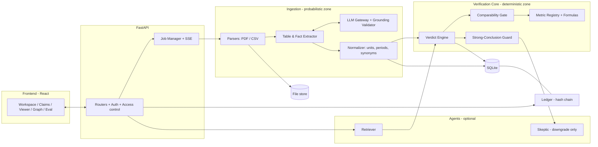
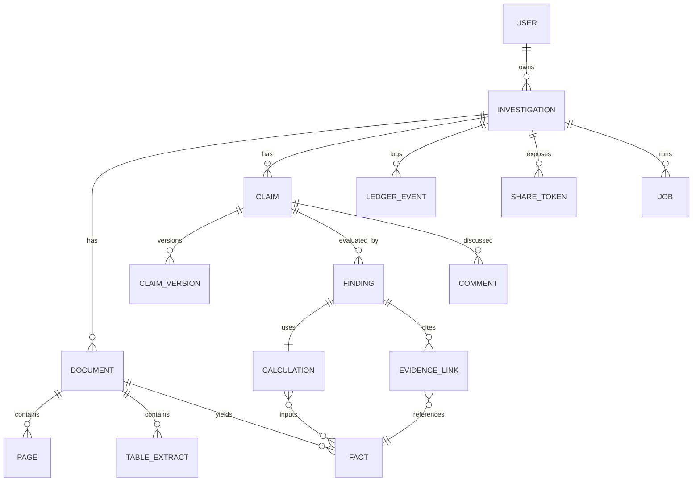
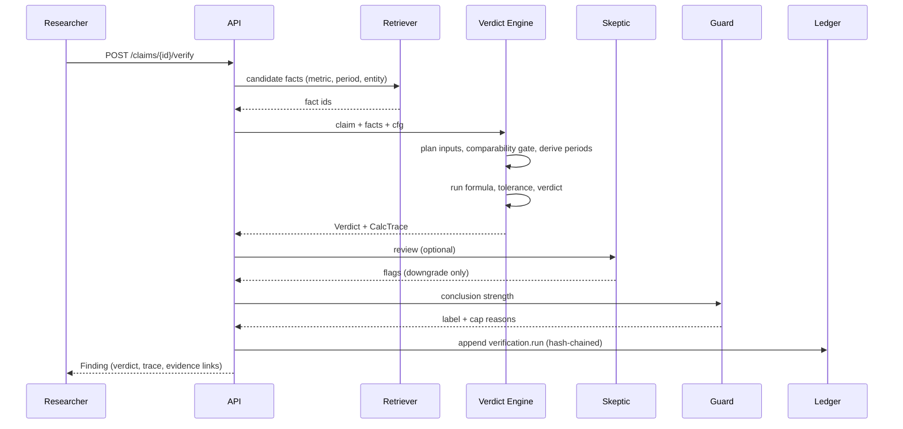

# ContradictIQ — Architecture

**Companion to:** `prd.md` | **Design/UI spec:** `design.md` (owned separately)

---

## 1. Architectural principles

1. **Trust boundary:** everything probabilistic (LLM, PDF table guessing) lives *outside* the **Verification Core**. The core is pure Python: no I/O, no network, no randomness.
2. **Typed everywhere:** Pydantic models at every boundary; LLM output is schema-validated and grounded before it enters the DB.
3. **Facts are immutable, interpretations are versioned.** Facts/Ledger append-only; claims/conclusions versioned.
4. **Provenance first:** a `Locator` (doc, page, bbox/char span, table cell) travels with every fact.
5. **Graceful degradation:** each external dependency has a fallback (LLM → rules, bbox → page-level, SSE → polling).
6. **Single deployable:** one backend process + one frontend; SQLite file; local file storage.

---

## 2. Technology choices

| Layer | Choice | Why |
|---|---|---|
| Backend | **Python 3.11 + FastAPI** | Fast to build, Pydantic, async, SSE |
| ORM/DB | **SQLAlchemy 2.0 + SQLite** (WAL mode) | Zero setup; swap to Postgres via URL |
| PDF parsing | **PyMuPDF (fitz)** for text + word bboxes; **pdfplumber** for tables | Coordinates for highlighting; table extraction |
| CSV | **pandas** (+ custom sniffing) | Layout/period detection |
| LLM | Provider interface: Gemini / Groq / OpenAI-compatible / Ollama / Anthropic via env var | Avoid single point of failure |
| Jobs | In-process `ThreadPoolExecutor` + DB `jobs` table | No Redis needed in 6 h |
| Realtime | **SSE** (`/jobs/{id}/events`) with polling fallback | Simple, proxy-friendly |
| Auth | JWT (python-jose) + bcrypt (passlib) | Standard |
| Frontend | **React + Vite + TypeScript + Tailwind** (+ shadcn/ui) | Speed |
| Viewer | **react-pdf** (pdf.js) + overlay highlights | bbox highlights |
| Graph | **React Flow** | Evidence graph |
| Charts | **Recharts** | Dashboard |
| Reports | **Jinja2** → HTML/Markdown (PDF via browser print) | No heavy deps |
| Tests | pytest, hypothesis (optional), Playwright smoke (optional) | |

> Final UI look & component choices are governed by `design.md`.

---

## 3. System overview



**Zones:** *Probabilistic zone* may be wrong → outputs carry `confidence` and need grounding. *Deterministic zone* is exact → fully unit-tested.

---

## 4. Repository structure

```
contradictiq/
├── backend/
│   ├── app/
│   │   ├── main.py                 # FastAPI app, CORS, routers
│   │   ├── config.py               # env settings
│   │   ├── db.py                   # engine, session, base
│   │   ├── models/                 # SQLAlchemy models
│   │   ├── schemas/                # Pydantic request/response
│   │   ├── api/                    # routers: auth, investigations, documents, claims, verify, ledger, reports, eval, share, jobs
│   │   ├── core/                   # ★ DETERMINISTIC ZONE (no I/O)
│   │   │   ├── periods.py          # Period, parse, algebra
│   │   │   ├── units.py            # Money/scale/currency normalization
│   │   │   ├── metrics.py          # registry + synonyms
│   │   │   ├── formulas.py         # pure formula functions w/ traces
│   │   │   ├── comparability.py    # gate
│   │   │   ├── tolerance.py        # precision-aware tolerance
│   │   │   ├── verdict.py          # ordered rules
│   │   │   └── guard.py            # strong-conclusion guard
│   │   ├── ingest/
│   │   │   ├── validators.py       # magic bytes, size, page limits
│   │   │   ├── pdf_parser.py       # pages, words+bbox, tables
│   │   │   ├── csv_parser.py       # layout sniffing, wide/long
│   │   │   ├── fact_extractor.py   # tables→facts, regex narrative facts
│   │   │   ├── claim_parser.py     # rule-based text→claim
│   │   │   └── pipeline.py         # orchestrates job steps
│   │   ├── llm/
│   │   │   ├── base.py             # Provider interface
│   │   │   ├── providers.py        # gemini/groq/openai/ollama/anthropic
│   │   │   ├── cache.py            # prompt-hash cache
│   │   │   ├── extract.py          # claim/fact extraction prompts + schemas
│   │   │   ├── grounding.py        # quote validation, number validation
│   │   │   └── narrate.py          # constrained explanations
│   │   ├── agents/
│   │   │   ├── retriever.py
│   │   │   ├── verifier.py         # calls core tools only
│   │   │   └── skeptic.py
│   │   ├── services/
│   │   │   ├── ledger.py           # append + verify hash chain
│   │   │   ├── versions.py
│   │   │   ├── jobs.py             # queue, status, SSE bus
│   │   │   ├── graph.py            # evidence graph builder
│   │   │   ├── reports.py
│   │   │   └── auth.py
│   │   └── eval/
│   │       ├── dataset.jsonl       # labelled cases
│   │       ├── run_eval.py
│   │       └── llm_baseline.py
│   ├── scripts/generate_demo_data.py
│   ├── tests/                      # core unit tests are the priority
│   └── requirements.txt
├── frontend/ (Vite + TS)
├── data/ (uploads, sqlite)  # gitignored
├── docs/ (prd.md architecture.md design.md tasks.md)
├── docker-compose.yml
└── Makefile                        # dev, test, seed, eval
```

---

## 5. Data model



### 5.1 Tables (key columns)

| Table | Columns |
|---|---|
| `users` | id, email (unique), password_hash, name, role (`user`), created_at |
| `investigations` | id, owner_id, title, description, status (`open/in_review/concluded`), archived (bool), entity_name, created_at, updated_at |
| `investigation_members` | investigation_id, user_id, role (`reviewer`/`viewer`) |
| `documents` | id, investigation_id, filename, mime, size, sha256, storage_path, page_count, source_tier (T1–T4), doc_date, entity_name, status (`queued/parsing/extracting/ready/failed`), error_code, error_msg, warnings_json, uploaded_by, created_at |
| `pages` | id, document_id, page_no, text, words_json (word, x0,y0,x1,y1, char_start,char_end) |
| `table_extracts` | id, document_id, page_no, bbox, header_json, rows_json, method (`pdfplumber/csv`), confidence |
| `facts` | id, document_id, metric (canonical), raw_label, value_raw, value_base (normalized to units, Decimal as string), unit, scale, currency, period_json, period_key, scope (`consolidated/standalone/segment:<name>`), basis (`reported/adjusted`), restated (bool), confidence (0–1), method (`csv/table/regex/llm`), confirmed (bool), locator_json (page, bbox, table_id, row, col, char_span, quote) |
| `claims` | id, investigation_id, current_version, state, created_by, origin (`manual/ai/parsed`), created_at |
| `claim_versions` | id, claim_id, version, text, claim_type, metric, value_raw, value_precision (decimals), unit, scale, currency, period_json, scope, basis, entity, source_doc_id, source_locator_json, quote, grounded (bool), author_id, created_at, change_note |
| `findings` | id, claim_version_id, verdict, severity, reason_codes_json, comparability_json, conclusion_strength (`confirmed/indicative/insufficient/disproved`), narrative, superseded (bool), calculation_id, created_at, engine_version |
| `calculations` | id, formula_id, input_fact_ids_json, steps_json, result_value, result_unit, tolerance_json, derived (bool), engine_version |
| `evidence_links` | id, finding_id, fact_id, stance (`supports/opposes/neutral/not_comparable`), document_id, locator_json, note |
| `comments` | id, claim_id/finding_id, author_id, body, assignee_id, status, created_at |
| `ledger_events` | id (seq), investigation_id, actor_id, type, payload_json, prev_hash, hash, created_at |
| `jobs` | id, investigation_id, document_id, type, status, progress (0–100), step, error, created_at, finished_at |
| `share_tokens` | id, investigation_id, token_hash, expires_at, scope (`read_only`) |
| `eval_runs` | id, created_at, engine_version, metrics_json, per_case_json |

**Indexes:** `facts(document_id, metric, period_key)`, `claims(investigation_id, state)`, `ledger_events(investigation_id, id)`, `documents(investigation_id)`.

**Decimal rule:** store financial numbers as strings of `Decimal` (or integer minor units) — never floats.

---

## 6. Ingestion pipeline & job system

### 6.1 Steps (per document, run as a background job)

```
UPLOAD → VALIDATE → STORE → PARSE → TABLES → FACTS(rule) → [LLM EXTRACT] → NORMALIZE → QUALITY CHECKS → READY
```

| Step | Detail | Progress % |
|---|---|---|
| Validate | extension + magic bytes (`%PDF-`), size, pages, CSV rows; reject encrypted PDFs | 5 |
| Store | save as `data/uploads/<sha256>.<ext>`; dedupe warning | 10 |
| Parse (PDF) | PyMuPDF: per-page text + word boxes; detect scanned (text length ≈ 0) → fail `SCANNED_PDF_UNSUPPORTED` | 30 |
| Tables | pdfplumber lattice/stream; keep tables with ≥2 numeric columns; header detection | 50 |
| Facts (rules) | map row labels via metric synonyms; detect scale/currency from caption ("₹ in crore"); periods from header cells ("Q3 FY25", "Year ended 31 Mar 2025") | 65 |
| LLM extract (optional) | claims + facts from narrative; grounding validator | 85 |
| Normalize | convert to base units; resolve period objects; set confidence | 92 |
| Quality checks | missing periods, duplicate facts, unit ambiguity, negative revenue, sum mismatch | 100 |

### 6.2 Job manager
- `jobs` table is the source of truth; `ThreadPoolExecutor(max_workers=2)` runs steps; each step updates `progress/step`.
- **SSE:** `GET /api/jobs/{id}/events` streams `{status, step, progress}`; frontend falls back to polling `GET /api/jobs/{id}` every 1.5 s.
- **Idempotent steps:** re-running a job for the same doc replaces its derived rows in one transaction.
- **Failure isolation:** exceptions caught per step → `status=failed`, `error_code`, partial results kept, investigation unaffected.

---

## 7. Extraction & the LLM boundary

### 7.1 Provider interface
```python
class LLMProvider(Protocol):
    def complete_json(self, system: str, user: str, schema: dict, *, temperature: float = 0) -> dict: ...
```
- Config: `LLM_PROVIDER`, `LLM_MODEL`, `LLM_API_KEY`, `LLM_BASE_URL`.
- Retry with backoff (2 attempts) → on failure return `None` → caller falls back to rules and sets doc warning `AI_UNAVAILABLE`.
- **Cache:** key = `sha256(provider+model+system+user)`; stored in SQLite `llm_cache`. Pre-warm by running the demo corpus once before judging.

### 7.2 Claim extraction schema
```json
{ "claims": [{
  "quote": "verbatim text from the page",
  "page": 3,
  "metric": "revenue",
  "claim_type": "GROWTH_YOY",
  "value": 25, "unit": "percent",
  "period": "FY2025",
  "entity": "Veridian Foods Ltd",
  "scope": "consolidated",
  "basis": "reported"
}]}
```

### 7.3 Grounding validator (hard gate)
For every AI-extracted claim/fact:
1. `quote` must appear in page text after whitespace normalization (exact or fuzzy ratio ≥ 0.92). Else **reject** → `UNGROUNDED_EXTRACTION` (logged, shown in UI as rejected).
2. Every number in the claim must appear in the quote (after unit/scale normalization). Else reject.
3. Metric must exist in registry (else map via synonyms or mark `unmapped`).
4. Compute char span → bbox via stored word boxes so the viewer can highlight.
5. Status = `Extracted (needs confirmation)`; AI claims are **never auto-verified** unless user enables "auto-confirm high confidence".

### 7.4 Prompt-injection containment
- Document text is wrapped in delimiters and labelled *untrusted data*; system prompt states instructions inside documents must be ignored.
- LLM can only return JSON matching a schema; no tools exposed to extraction calls.
- The LLM never receives credentials or other investigations' data.
- Output validated by grounding; injected "verdicts" have no pathway into the verdict engine.

### 7.5 Narrative generation (constrained)
- Template-first explanation generated by code: *"Computed revenue growth = (₹3,400 − ₹2,977) / ₹2,977 = 14.2%; claim states 25%; difference 10.8 pp exceeds tolerance 0.5 pp."*
- LLM may paraphrase **only** if a **number checker** confirms every number in the output exists in the trace; otherwise discard the paraphrase and keep the template.

---

## 8. Normalization

### 8.1 Units & currency (`core/units.py`)
```python
SCALE = {"unit":1, "thousand":1e3, "lakh":1e5, "million":1e6, "crore":1e7, "billion":1e9, "bn":1e9, "mn":1e6, "cr":1e7, "k":1e3}
```
- Parse strings such as `₹3,400 cr`, `$4.2B`, `(1,234)` (negative), `12.5%`.
- All money converted to `Decimal` in **base currency units**; original text preserved.
- Currency symbols → ISO (`₹→INR`, `$→USD`, `€→EUR`). **No FX conversion**: different currencies ⇒ `CURRENCY_MISMATCH` unless user supplies a rate (stretch).
- Precision captured: number of decimals in the stated value (drives tolerance).

### 8.2 Periods (`core/periods.py`)
```python
@dataclass(frozen=True)
class Period:
    kind: Literal["Q","H","9M","FY","TTM"]
    fy: int               # fiscal year label, e.g. 2025
    idx: int | None       # quarter 1-4 or half 1-2
    fy_end_month: int = 3 # India default Mar; configurable per investigation
```
- Parser handles: `Q3 FY25`, `Q3 FY2025`, `Jul–Sep 2024`, `FY25`, `year ended 31 March 2025`, `H1 FY25`, `nine months ended …`, calendar-year variants.
- **Algebra:** `Q1+Q2+Q3+Q4 → FY`, `Q1+Q2 → H1`, `Q1+Q2+Q3 → 9M`, `prev_year(p)`, `prev_quarter(p)`.
- Flow metrics (revenue, expenses, profit) are additive across quarters; **stock metrics** (assets, debt) are not — registry marks `additive: bool`.

---

## 9. Metric registry & formulas

```python
METRICS = {
  "revenue":            Metric(additive=True,  synonyms=["net sales","turnover","total income from operations","revenue from operations"]),
  "cogs":               Metric(additive=True,  synonyms=["cost of goods sold","cost of materials consumed","cost of sales"]),
  "gross_profit":       Metric(additive=True,  derivable_from=("revenue","cogs")),
  "operating_expenses": Metric(additive=True,  synonyms=["opex","operating costs","total operating expenses"]),
  "operating_income":   Metric(additive=True,  synonyms=["ebit","operating profit"]),
  "ebitda":             Metric(additive=True,  synonyms=["ebitda"]),
  "net_income":         Metric(additive=True,  synonyms=["profit after tax","pat","net profit"]),
  "total_expenses":     Metric(additive=True,  synonyms=["total expenses"]),
}
FORMULAS = {
  "growth_yoy":     inputs=[(metric, P), (metric, prev_year(P))], f=(cur-prev)/prev*100,
  "growth_qoq":     inputs=[(metric, P), (metric, prev_quarter(P))],
  "gross_margin":   (revenue-cogs)/revenue*100,
  "operating_margin": operating_income/revenue*100,
  "net_margin":     net_income/revenue*100,
  "expense_ratio":  total_expenses/revenue*100,
  "opex_ratio":     operating_expenses/revenue*100,
}
```
Each formula returns `CalcResult(value, unit, steps=[Step(label, expr, values, result)], inputs=[fact_id...])`. Division by zero / negative base ⇒ `Inconclusive/UNDEFINED_GROWTH_BASE`.

**Synonym matching:** exact lowercase match → token-set fuzzy (≥ 0.9) → LLM suggestion (if enabled, must be confirmed). Ambiguous label (e.g., "Income") → `unmapped`, flagged.

---

## 10. Comparability Gate & Verdict Engine (the heart)

### 10.1 Gate checks (all must pass or be *resolvable*)

| Check | Pass | Resolvable by | Else reason code |
|---|---|---|---|
| Metric | same canonical metric | synonym map | `METRIC_MISMATCH` |
| Entity | same entity (fuzzy ≥ 0.9) | — | `ENTITY_MISMATCH` |
| Period | same `Period` | period algebra (derive FY from 4 quarters) | `PERIOD_MISMATCH` |
| Period kind | same kind | derivation only if metric additive & all components exist | `NOT_COMPARABLE_PERIOD_KIND` |
| Scope | same scope | — | `SCOPE_MISMATCH` |
| Basis | reported vs reported | — | `BASIS_MISMATCH` (adjusted vs reported) |
| Currency | same ISO | user-provided FX | `CURRENCY_MISMATCH` |
| Scale | any | auto-normalized | — |
| Restatement | not restated or same restatement version | prefer latest restated, flag | `RESTATEMENT_AMBIGUITY` |

### 10.2 Ordered verdict rules

```python
def decide(claim, evidence_facts, cfg) -> Verdict:
    # R1
    if not claim.parseable:                      return INCONCLUSIVE("UNPARSEABLE_CLAIM")
    # R2
    plan = plan_inputs(claim)                    # which facts the formula needs
    missing = [i for i in plan if not resolve(i, evidence_facts)]
    if missing:                                  return INCONCLUSIVE("MISSING_INPUT", missing)
    # R3  comparability (derive if possible)
    gate = check_comparability(claim, plan, evidence_facts)
    if gate.blocked:                             return INCONCLUSIVE("NOT_COMPARABLE", gate.reasons)
    # R4  source disagreement among same-tier facts
    if gate.same_tier_disagreement:              return INCONCLUSIVE("SOURCE_DISAGREEMENT", gate.facts)
    # R5  confidence
    if min_conf(gate.inputs) < cfg.min_conf and not all_confirmed(gate.inputs):
                                                 return INCONCLUSIVE("LOW_CONFIDENCE_EXTRACTION")
    # R6  compute + compare
    calc = run_formula(claim, gate.inputs)       # deterministic
    tol  = tolerance(claim, cfg)
    dev  = abs(calc.value - claim.value)
    if dev <= tol:                               return CONSISTENT(calc, severity="Match")
    sev  = "NearMiss" if dev <= 3*tol else "Material"
    return CONFLICTING(calc, severity=sev)
```
*Skeptic post-processing (optional):* can convert `Consistent/Conflicting → Inconclusive` with a reason (e.g., `POSSIBLE_RESTATEMENT`), **never the reverse**.

### 10.3 Precision-aware tolerance
```python
def tolerance(claim, cfg):
    half_ulp = Decimal(5) * Decimal(10) ** -(claim.precision + 1)   # "18%" -> 0.5 ; "18.2%" -> 0.05
    approx   = cfg.approx_multiplier if claim.hedged else 1         # "about/around" -> x2
    return max(half_ulp * approx, cfg.min_abs_tol)                  # percent claims
    # absolute-value claims: relative tolerance = half_ulp of the stated figure at its scale
```
Direction claims (`DIRECTION`: "profit declined") compare sign of computed change; zero change → `Inconclusive/ZERO_CHANGE`.

### 10.4 Strong-Conclusion Guard (`core/guard.py`)

| Conclusion label | Requires |
|---|---|
| **Disproved** | verdict `Conflicting` + severity `Material` + all inputs from `csv/table` method **or** human-confirmed + ≥1 locator per input + no open data-quality errors on those docs + gate clean |
| **Confirmed** | verdict `Consistent` + same provenance requirements |
| **Indicative** | verdict decided but at least one input is `regex/llm` unconfirmed, or derived value used, or `NearMiss` |
| **Insufficient evidence** | any `Inconclusive` |

UI shows the label and **why it was capped**. This directly answers "prevent strong conclusions when evidence is incomplete/incomparable."

---

## 11. Agents (optional, FR-17)

| Agent | Role | Constraints |
|---|---|---|
| **Retriever** | Given a claim, finds candidate facts/passages (keyword + metric/period filter; optional embedding rerank) | Returns IDs only; cannot create facts |
| **Numeric Verifier** | Calls `core` functions via typed tool interface; returns the CalcResult | No free-text numbers; pure function calls |
| **Skeptic** | Reviews gate result + trace; produces risk flags (`POSSIBLE_RESTATEMENT`, `ADJUSTED_VS_REPORTED`, `FISCAL_YEAR_BOUNDARY`) | May **downgrade** only; each flag requires cited evidence locator |

Orchestration is a simple sequential pipeline: `Retriever → Verifier → Engine → Skeptic → Guard`. The *engine*, not an LLM, is the arbiter. All agent I/O is logged in the ledger (`agent_step` events) so judges can inspect.

---

## 12. Evidence graph

Built on demand (`services/graph.py`) from DB:
- **Nodes:** `Claim`, `Metric`, `Fact`, `Document`, `Calculation`, `Conclusion`
- **Edges:** `claim —about→ metric`, `fact —extracted_from→ document`, `calculation —computed_from→ fact`, `conclusion —supports/opposes→ claim`
- API returns `{nodes:[{id,type,label,data}], edges:[{source,target,type}]}`; React Flow lays it out (dagre). Clicking a node opens the matching detail/locator.

---

## 13. Ledger & versioning

### 13.1 Hash-chained ledger
```python
hash = sha256(prev_hash + canonical_json({type, actor, payload, ts}))
```
- Event types: `investigation.created/updated/archived`, `document.uploaded/processed/failed`, `fact.confirmed`, `claim.created/updated/confirmed`, `verification.run`, `finding.superseded`, `agent.step`, `comment.added`, `share.created`, `report.exported`.
- `GET /investigations/{id}/ledger/verify` recomputes the chain → `{valid: true, length: N}`; shown as a badge in UI ("Integrity verified ✓").
- "State as of event N": rebuild claims/findings views by filtering `created_at <= event.ts` and `superseded` flags.

### 13.2 Versioning
- Claim edit ⇒ insert `claim_versions` row (version+1), mark previous findings `superseded=true`, auto-queue re-verification, emit ledger events.
- Diff endpoint returns field-level changes.

---

## 14. API (REST, `/api`)

| Area | Endpoint | Notes |
|---|---|---|
| Auth | `POST /auth/register`, `POST /auth/login`, `GET /auth/me` | JWT bearer |
| Investigations | `GET/POST /investigations`, `GET/PATCH /investigations/{id}`, `POST /investigations/{id}/archive` | owner-scoped |
| Documents | `POST /investigations/{id}/documents` (multipart), `GET .../documents`, `GET /documents/{id}`, `GET /documents/{id}/file`, `GET /documents/{id}/pages/{n}`, `GET /documents/{id}/facts`, `PATCH /facts/{id}` (confirm/edit) | |
| Claims | `GET/POST /investigations/{id}/claims`, `PATCH /claims/{id}` (new version), `POST /claims/{id}/confirm`, `GET /claims/{id}/versions`, `POST /investigations/{id}/claims/extract` (AI, job) | |
| Verify | `POST /claims/{id}/verify`, `POST /investigations/{id}/verify-all` (job), `GET /findings/{id}` (trace, links) | |
| Evidence | `GET /findings/{id}/evidence`, `GET /investigations/{id}/graph` | |
| Compare | `GET /investigations/{id}/compare?docA=&docB=&metrics=` | aligned metric×period table |
| Comments | `GET/POST /claims/{id}/comments`, `PATCH /comments/{id}` | |
| Dashboard | `GET /investigations/{id}/dashboard` | aggregated counts + unresolved queue |
| Ledger | `GET /investigations/{id}/ledger`, `GET .../ledger/verify` | |
| Reports | `GET /investigations/{id}/report?format=html|md` | |
| Share | `POST /investigations/{id}/share` → token; `GET /shared/{token}/...` mirrors read endpoints | read-only |
| Jobs | `GET /jobs/{id}`, `GET /jobs/{id}/events` (SSE) | |
| Eval | `POST /eval/run`, `GET /eval/runs/latest` | |

**Standard error body:** `{ "error": { "code": "NOT_COMPARABLE", "message": "...", "details": {...} } }`

---

## 15. Authentication & access control

- `get_current_user` dependency → user id from JWT.
- **All queries go through repository helpers** that filter by owner/membership (`investigation_access(user, inv_id, min_role)`); resource lookups for documents/claims/findings join back to the investigation.
- Unauthorized or non-existent ⇒ **404** (no existence leak).
- Roles per investigation: `owner` (all), `reviewer` (comment/approve/verify), `viewer` (read).
- **Share tokens:** random 32-byte token, store only hash, expiry (default 7 days), read-only router namespace, no mutation endpoints reachable.
- File downloads go through the API (auth-checked), never static paths.
- Rate limiting for auth and LLM endpoints (simple in-memory limiter).

---

## 16. Reporting

Jinja2 template sections: Executive summary → Scope & documents (with hashes) → Findings table (verdict, strength) → Per-finding detail (claim, calc trace, evidence refs with page numbers) → Unresolved & data-quality issues → Methodology & limitations → Ledger integrity statement (head hash). Served as HTML (print-to-PDF friendly CSS) and Markdown.

---

## 17. Evaluation harness

- `eval/dataset.jsonl`: each case = `{id, category, facts[], claim{}, expected_verdict, expected_reason?}`.
- **Categories (≥ 8 per bucket):** `clean_consistent`, `clean_conflicting`, `rounding_ok`, `quarter_vs_annual_trap`, `scale_mismatch_ok`, `currency_mismatch`, `missing_input`, `adjusted_vs_reported`, `restatement`, `source_disagreement`, `malformed`.
- `run_eval.py` runs the **real engine** (not mocks) and outputs: accuracy, per-class precision/recall/F1, confusion matrix, **false-positive rate = P(predicted Conflicting | truth ≠ Conflicting)**, per-category pass rate, failing cases list.
- `llm_baseline.py` asks an LLM "is this claim consistent with these facts?" with same inputs → computes same metrics → comparison table in UI.
- Eval page shows results with the engine version and dataset hash.

---

## 18. Error handling matrix

| Situation | Behavior |
|---|---|
| Wrong file type / spoofed extension | 415 `UNSUPPORTED_FILE_TYPE` / `MAGIC_BYTES_MISMATCH` |
| Oversized | 413 `FILE_TOO_LARGE` |
| Encrypted/corrupt PDF | doc `failed`, `PDF_UNREADABLE` |
| Scanned PDF | doc `failed`, `SCANNED_PDF_UNSUPPORTED` (hint: upload text PDF/CSV) |
| CSV missing required columns | `CSV_SCHEMA_INVALID` with list of detected vs expected |
| Unparseable number ("n/a", "--") | fact skipped, quality warning `UNPARSEABLE_VALUE` with cell ref |
| Negative/zero growth base | `UNDEFINED_GROWTH_BASE` |
| LLM timeout/invalid JSON | retry → fallback; warning `AI_UNAVAILABLE` |
| Ungrounded extraction | rejected, listed in "Rejected by validator" panel |
| Concurrent edits | optimistic `version` check → 409 with latest state |

---

## 19. Security checklist

- [ ] bcrypt password hashing, JWT expiry (24 h), secrets via env
- [ ] CORS restricted to frontend origin
- [ ] Upload: magic bytes, size/page limits, random storage names, no path traversal
- [ ] SQLAlchemy parameterized queries only
- [ ] Output sanitization in report HTML (Jinja autoescape ON)
- [ ] Prompt-injection containment (§7.4)
- [ ] Share tokens hashed, expiring, read-only
- [ ] Ownership tests automated (B7)

---

## 20. Testing strategy (time-boxed priorities)

1. **Core unit tests (must):** units parsing, period parsing/algebra, each formula, tolerance, gate, verdict table — parametrized with ≥ 60 cases. Reuse eval dataset as test fixtures.
2. **Ingestion tests:** CSV wide/long, PDF table of the generated demo PDFs.
3. **API tests:** auth isolation, upload validation, verify happy path.
4. **Smoke e2e script:** `scripts/smoke.py` runs register → create → upload → extract → verify → report; run before every checkpoint and before the demo.

---

## 21. Configuration & deployment

```env
DATABASE_URL=sqlite:///./data/app.db
JWT_SECRET=change-me
LLM_PROVIDER=gemini|groq|openai|ollama|anthropic|none
LLM_MODEL=...
LLM_API_KEY=...
MAX_UPLOAD_MB=20
FY_END_MONTH=3
MIN_CONFIDENCE=0.8
```
- `make dev` → backend `uvicorn app.main:app --reload`, frontend `vite`.
- `make seed` → demo user + generated documents + labelled eval dataset.
- `docker-compose.yml` (backend, frontend served by nginx or vite preview) as a nice-to-have; primary demo runs locally with a pre-seeded DB **and a pre-warmed LLM cache**.
- Scale path (slide only): SQLite → Postgres, ThreadPool → Celery/RQ + Redis, local files → S3, in-memory SSE → Redis pub/sub.

---

## 22. Key sequence — "verify a claim"


